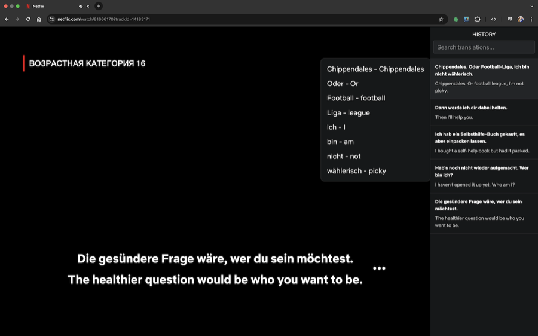

# Double Subtitles

A Chrome extension that shows a second, translated subtitle line under the original one on Netflix, Prime Video, Disney+, YouTube and Twitch. Built for language learners who want to watch in the language they are learning and still follow the story.

Install: [Chrome Web Store](https://chromewebstore.google.com/detail/cpnlpffdpcpoabpahdgfnecgngapjibn) | [Product page](https://mrwd.github.io/products/double-subtitles/)



## What it does

- Reads the subtitles the player is already showing and adds a translated line under them.
- Click a word or phrase to see its translation in a small modal and hear it read aloud.
- Save phrases you want to remember. They show up in a sidebar next to the video, with search and history. Each saved phrase keeps the video timestamp, so clicking it jumps the player back to that moment.
- Optionally show captions or translations only while the video is paused.
- Drag the subtitles where you want them, and adjust font size and colours for subtitles and the sidebar.
- UI is translated into 13 languages (de, en, es, fr, it, ja, ko, pl, pt, ru, tr, uk, zh).
- Saved phrases are kept in `chrome.storage.sync`, so they follow your Chrome profile. Nothing is sent anywhere except the text being translated.

## Supported streaming services

- Netflix
- Amazon Prime Video (primevideo.com and amazon domains)
- Disney+
- YouTube
- Twitch

## Learning platform helpers

When you open the "add card" form on AnkiWeb (ankiuser.net) or Quizlet, the extension shows a tip with your saved phrases so you can fill the card with one click.

The save menu also has checkboxes for sending a card straight to Anki, Quizlet or a Google Sheet. Those go through a small local companion server on `http://127.0.0.1:5000` that lives in a separate, private repo. Without it running, those checkboxes do nothing; saving to the browser works on its own.

## Installation

From the store: use the [Chrome Web Store](https://chromewebstore.google.com/detail/cpnlpffdpcpoabpahdgfnecgngapjibn) link above.

From source:

1. Clone the repository:
   ```bash
   git clone https://github.com/mrWD/double-subtitles.git
   ```
2. Open `chrome://extensions`.
3. Enable Developer mode.
4. Click "Load unpacked" and select the cloned folder.

There is no build step. It is plain JavaScript, HTML and CSS.

## Usage

1. Open a video on a supported site and turn on the player's own subtitles.
2. Click the Double Subtitles icon and pick your language and the language you are learning.
3. Watch. Click any phrase to translate it, save it, or hear it.

## How it works

- `manifest.json`: Manifest V3, content scripts, host permissions.
- `content.js`: entry point. Detects the streaming site and whether the current page is a watch page, watches SPA navigation, and cleans up injected UI when you leave.
- `src/utils.js`: per-platform adapters. Each site exposes its subtitles in a different part of the DOM, so this is where Netflix, Prime, Disney+, YouTube and Twitch are handled.
- `src/netflixBridge.js`: a small script injected into the page world on Netflix. Seeking the Netflix player and reading its current time only works through the page's own player API, which a content script cannot reach.
- `src/subtitles.js`, `src/subtitlesManager.js`: render the second line and keep it in sync with the original. Translations are requested asynchronously and tagged with a request id; `content.js` drops a response whose id is older than the last one applied, so a slow reply for an old caption never overwrites a newer one (this matters on YouTube, where captions change fast).
- `src/sidebar.js`, `src/savedCards.js`, `src/cardMenu.js`, `src/translationModal.js`: the sidebar, saved cards, the save menu and the click-to-translate modal.
- `src/serviceIntegrations.js`: saving to browser storage, and the optional Anki / Quizlet / Google Sheets hooks.
- `src/autofill.js`: the saved-phrase tip on AnkiWeb and Quizlet card forms.
- `src/i18n.js`, `_locales/`: UI translations.
- `background.js`: service worker. Handles text-to-speech via the Chrome TTS API.
- `popup.html`, `popup.js`: the settings popup.

Translation uses the public `translate.googleapis.com` endpoint. It has no auth and can change without notice, so this is the most fragile part.

## Roadmap

Rough order, no dates:

- Firefox and Safari builds.
- Apple TV+ support.
- Show base forms of verbs and nouns next to the translation.
- Export the whole history, split by title.
- Keyboard navigation and screen reader support.

## Fixing a site layout change without a release

Each site's caption element class lives in [selectors.json](selectors.json). The extension downloads that file from `main` at browser start and once a day, validates it (a single plain CSS class name per platform, nothing else) and keeps the last good copy. If a platform renames its caption class, edit `selectors.json` through a PR; users get it within a day, no store release needed. If a site changes its markup structure rather than a class name, or YouTube/Twitch (handled in code), a release is still required. Tests: `node test/selectors.test.js`.

## Releasing

Pushing a tag like `v1.0.4` publishes the extension to the Chrome Web Store via `.github/workflows/publish.yml`. Bump `version` in `manifest.json` first; the workflow fails if the tag and the manifest version differ. It needs these repository secrets: `CWS_EXTENSION_ID`, `CWS_CLIENT_ID`, `CWS_CLIENT_SECRET`, `CWS_REFRESH_TOKEN`.

## Privacy

See [PRIVACY.md](PRIVACY.md).

## Contributing

1. Fork the repository.
2. Create a new branch (`git checkout -b feature-branch`).
3. Commit your changes.
4. Push to the branch and open a Pull Request.

## License

MIT, see [LICENSE](LICENSE).
